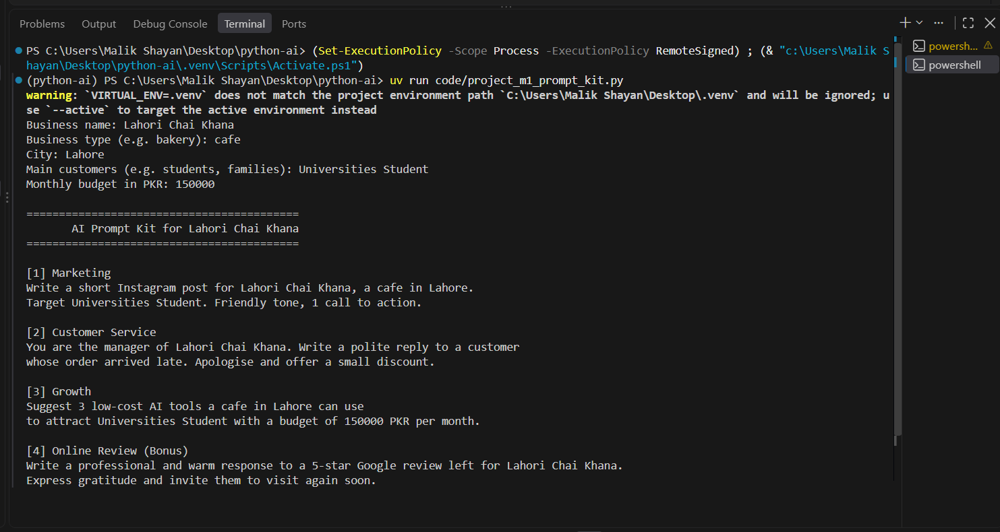
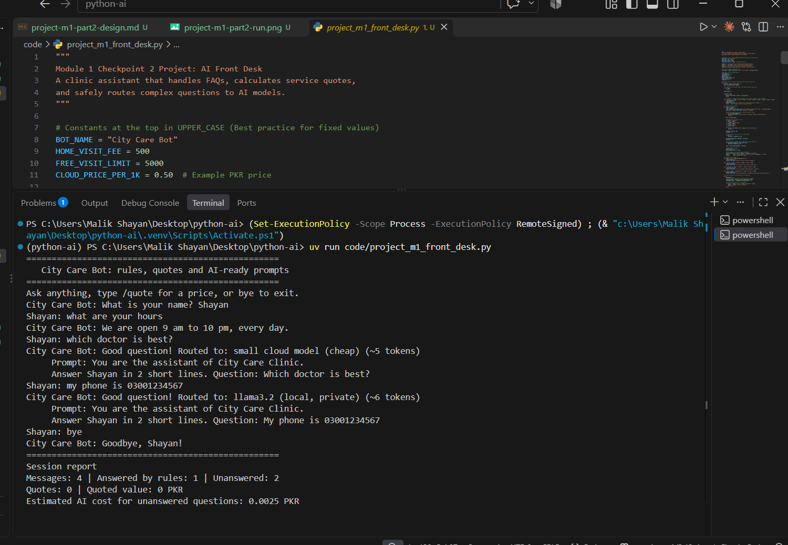

# Shayan Tabani
**Course:** Python for AI
**My AI Goal:** To build intelligent AI tools and assistants that solve real-world problems for local businesses.

**Main Run Command:** `uv run main.py`

## Lessons Done
- Module 1: Lessons 1.1 to 1.8 (Completed)
- Module 1: Final Project (Completed)
- Module 2: Lessons 2.1 to 2.4 (Completed)
- Module 2: Checkpoint 1 (Completed)

---
## Module 1 Project: AI Prompt Kit

A Python tool that turns a local business's details into ready-to-use AI prompts.

**Run:** `uv run code/project_m1_prompt_kit.py`

**Who would pay for this:** Cafe and small shop owners who want AI help but don't know what to type.
### Chatbot Design Table (City Care Clinic)
| Intent | Keywords | Bot Reply |
| :--- | :--- | :--- |
| 1. Timings | timing, open, close, hours | We are open 10 am to 8 pm, Monday to Saturday. |
| 2. Fees | fee, cost, price | Consultation fee is 2,000 PKR. |
| 3. Location | location, address, where | We are located at Main Boulevard, Lahore. |
| 4. Complaint (Handover) | complaint, late, agent, human | Sorry about that. Connecting you to a human... |
| 5. Exit | bye, exit | Take care! |

## Module 1 Final Project: AI Front Desk

A smart front desk assistant for City Care Clinic that handles FAQs, provides instant price quotes with discounts, and routes complex questions to AI safely.

**Run:** `uv run code/project_m1_front_desk.py`

**Value to owner:** Saves staff time by answering common questions instantly, eliminates human errors in pricing, and cuts AI costs by handling 80% of queries for free via rules.